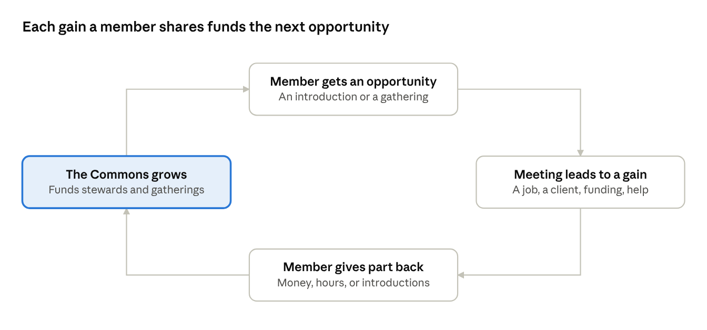
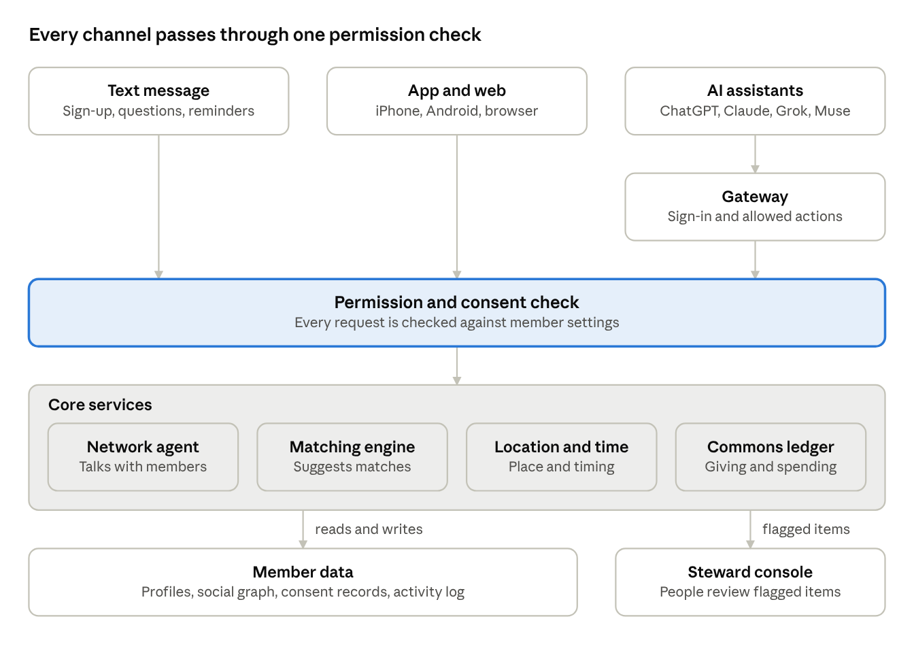
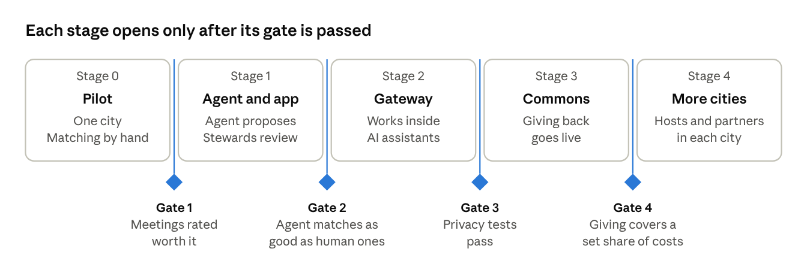

# The Network: Product Requirements Document

October 12, 2026 · Josie Rigali

## 1. Executive summary and pitch

The Network is a members' network that brings each member the right people and chances at the right time.

Members say what they are working toward and what they can offer. An AI agent looks for moments where two or more members can help each other. It proposes an introduction or a small gathering. Both sides must say yes before anything is shared.

Members reach The Network by text message, a phone app, the web, or the AI assistant they already use.

There is no monthly fee. Members give back to a shared pool when The Network helps them gain. The pool pays for the service.

**The pitch:** Tell The Network what you are working toward. It finds the people who can help you and the people you can help. Then it sets up the meeting.

**Draft status:** This is a first draft written from the section outline. Items marked *To confirm* need the owner's decision. Section 27 lists them.

## 2. Problem: why lives contract

Most adults' circles shrink every year, and their opportunities shrink with them.

- **Built-in mixing ends.** School, first jobs, and shared housing put new people in front of us. Those settings end.
- **Routine takes over.** Work, family, and commuting fill the week. People see the same faces in the same places.
- **Chance meetings get rarer.** Remote work and screen time remove many casual run-ins.
- **Contacts fade.** People move, change fields, and lose touch. Few new contacts replace them.
- **Opportunity travels through people.** Jobs, deals, collaborators, and friends mostly arrive through someone you know. A smaller circle brings fewer of them.

Current tools leave the work to the member. Professional directories require cold outreach. Swipe apps take hours and most matches go nowhere. Events are hit or miss. Private clubs charge monthly fees.

The result is idle resources. People hold skills, money, time, and contacts that never reach the person who needs them.

## 3. Product vision, goals, and non-goals

**Vision:** Every member's life gets bigger each year they belong, with more useful relationships and more opportunities acted on.

**Goals for the first version**

1. A new member joins with a phone number in a few minutes.
2. Each active member gets a small number of well-chosen opportunities, each with a clear reason.
3. Introductions lead to real meetings that members rate as worth their time.
4. Members can use The Network inside ChatGPT, Claude, Grok, and Muse.
5. The service pays for itself from member contributions and partners.
6. Members see and control everything The Network knows about them.

**Non-goals**

- A feed, posts, likes, or follower counts.
- A public directory where members browse or search each other.
- Advertising or selling member data.
- Maximizing time spent in the app.
- Automated decisions on sensitive matters without a human check.

## 4. Foundational product principles

Nine rules guide every product decision.

1. **Expansion is the measure.** Every feature is judged by whether members' lives get bigger.
2. **Few and good.** Each member receives a small number of well-chosen opportunities.
3. **Both sides gain.** An introduction goes ahead only when each person has a reason to say yes.
4. **Consent first.** Nothing about a member is shared without their yes.
5. **Ask little, learn over time.** The Network asks one question at a time, when it matters.
6. **Meet members where they are.** Text, app, web, and AI assistants all work.
7. **Real life counts.** Success means people met, worked together, or helped each other.
8. **Give back to the pool.** Value created through The Network helps fund The Network.
9. **Humans handle the sensitive calls.** People review safety issues, disputes, and high-stakes matches.

## 5. Capital as a vector

Capital is anything a member has that can help someone else. A vector is an amount with a direction. The Network records both: how much a member has, and where they want it to go.

Example: "I have $50,000 to invest" is an amount. "I want to invest $50,000 in early food businesses in Miami this year" is a vector. The second one can be matched.

| Type of capital | Plain meaning | Example with a direction |
| --- | --- | --- |
| Financial | Money | Funds to lend to local shops this year |
| Skills | Things you can do | Ten hours a month of design help for nonprofits |
| Knowledge | Things you know | Advice on food permits for new restaurant owners |
| Social | People you know | Introductions to hiring managers in healthcare |
| Reputation | Your name and track record | A reference for a former teammate |
| Physical | Space and tools | A workshop free on weekends for makers |
| Time and attention | Hours and care | Weekly mentoring for a first-time founder |

Needs are recorded the same way: what a member is looking for, how much, by when, and where. A match exists when one member's offer points at another member's need. The strongest matches run in both directions.

*To confirm: the final list of capital types.*

## 6. The opportunity model: engineered synchronicity

Synchronicity is a well-timed coincidence: meeting the exact person you needed at the moment you needed them. These moments usually depend on luck. The Network arranges them on purpose.

Every opportunity has five parts.

| Part | Question it answers |
| --- | --- |
| Who | Which members fit each other? |
| Why | What does each person gain? |
| When | When is the need live, and when are both free? |
| Where | Where can both get to, in person or online? |
| How | What is the first step: a message, a coffee, a small gathering? |

Opportunity types in the first version:

- **Introduction.** Two members who can help each other.
- **Small gathering.** A handful of members with a shared goal.
- **Ask or offer.** One member needs something specific that another can give.
- **Same place, same time.** Two matched members will be in the same city or neighborhood.

Each opportunity moves through the same steps: spotted, proposed privately to each side, accepted by both, scheduled, held, and reported back. Either side can pass. A pass stays private.

## 7. Members, roles, and participation states

Every person in The Network is a member. Some members take on extra roles.

| Role | What they do |
| --- | --- |
| Member | Shares goals and offers, receives opportunities, meets people, gives back |
| Host | Runs small gatherings for members |
| Steward | Looks after the network: reviews flagged matches, handles reports, supports hosts |
| Partner | An outside venue or organization that brings space or opportunities to members |

A participation state tells The Network how much a member wants right now.

| State | What it means |
| --- | --- |
| Invited | Has an invite and has yet to join |
| Joined | Phone verified, first questions in progress |
| Active | Open to opportunities up to their chosen limit |
| Focused | Wants only the strongest matches for a set period |
| Paused | Receives nothing; profile is kept |
| Restricted | Under review after a report |
| Left | Account closed; data deleted on request |

Members switch between Active, Focused, and Paused at any time.

*To confirm: role names, and whether hosts and stewards are paid.*

## 8. End-to-end member experience

A member goes from invite to giving back in ten steps.

1. **Invite.** A member or host sends an invite link by text.
2. **Join.** The new member enters a phone number and confirms a code.
3. **First conversation.** The agent asks three questions: what are you working toward, what can you offer, and where are you based.
4. **First opportunity.** The agent proposes a first introduction and explains why.
5. **Yes or pass.** The member answers. The other person does the same.
6. **Schedule.** The agent suggests a time and place that suit both.
7. **Meet.** The members meet in person or online.
8. **Report back.** Each member answers two questions: did it happen, and was it worth it.
9. **Learn.** The agent updates each profile from the answers.
10. **Give back.** When a meeting leads to a real gain, the member contributes to the Commons.

## 9. Phone-first onboarding and progressive profiling

A phone number is the account, and the profile builds a little at a time.

**Phone-first**

- The member enters a phone number and confirms a text code. There is no password and no long form.
- One phone number means one real person, which limits fake accounts.
- The first conversation can happen entirely by text, before the app is installed.

**Progressive profiling** means asking for information in small steps, at the moment it is useful.

| When | What The Network learns | How |
| --- | --- | --- |
| First day | Name, city, one goal, one offer | Three questions from the agent |
| First weeks | More goals and offers, availability, meeting preferences | Short follow-up questions |
| Ongoing | Which kinds of matches work | Accepts, passes, and meeting feedback |
| Optional | Calendar, contacts, work history | The member connects each one separately |

Every profile fact shows where it came from: told by the member, imported from a connected account, or guessed by the agent. The member can edit or delete any of them.

## 10. Native app and web UX/UI

The app is built around a conversation and a short list of current opportunities.

| Screen | What it shows |
| --- | --- |
| Today | Current opportunities, each with a reason and a yes or pass button |
| Chat | Conversation with the agent |
| My capital | What I offer and what I am looking for |
| People | Members I have met through The Network, with my notes |
| Commons | What I have given, what I have received, and how the pool is spent |
| Privacy | Everything The Network knows about me, with controls to edit, pause, or delete |

The app runs on iPhone and Android. The web version uses the same account. It handles invite links, longer profile edits, and tools for hosts and stewards.

Design rules:

- One clear action per screen.
- Plain language everywhere.
- Notifications are rare, and each one asks for a specific decision.
- Members cannot browse or search other members.
- Text size, contrast, and screen-reader support meet accessibility standards.

## 11. The Network Gateway: ChatGPT, Claude, Grok, Muse, and future assistants

The Gateway is the door that lets an AI assistant work with The Network on a member's behalf.

A member connects their account once inside ChatGPT, Claude, Grok, or Muse. After that they can ask the assistant things like "Who should I meet in Austin next week?"

How it works:

1. The member chooses The Network inside their assistant.
2. They sign in with their phone number and approve what the assistant may do.
3. The assistant can then use a fixed set of actions on that member's account.

| The assistant can | The assistant cannot |
| --- | --- |
| Read the member's own profile and opportunities | See another member's details before both have said yes |
| Update goals, offers, and availability | Browse or search the member list |
| Accept or pass on an opportunity, after the member confirms | Change privacy settings |
| Report how a meeting went | Handle payments |

The Gateway uses one open connector standard, so future assistants plug in without a custom build. The member can disconnect any assistant at any time.

*To confirm: which assistant launches first.*

## 12. The Network agent

The agent is The Network's own AI helper. It talks with members, keeps profiles current, spots opportunities, and sets up meetings.

**One-page agent spec**

| Dimension | Choice for The Network |
| --- | --- |
| AI tasks | **Converse** with members during onboarding and check-ins. **Extract** goals, offers, and needs from what members say. **Classify** capital types and safety flags. **Rank** possible matches. **Generate** the reason and the introduction for each side. **Summarize** outcomes. |
| Human actions | Members confirm guessed profile facts. Members accept or pass on every opportunity. Both sides say yes before an introduction. Stewards review flagged and high-stakes matches. Stewards handle reports and appeals. |
| System ops | Scheduled matching runs. Capacity limits for each member. Routing to text, app, or assistant. Calendar and location lookups where permitted. A log of every agent action. |
| Data | **In:** member messages, profile, availability, permitted location, meeting feedback. **Out:** profile updates, opportunity cards, introductions, reminders, flags for stewards. |
| Constraints | Shares nothing between members before both say yes. Never guesses or stores sensitive traits. Gives no financial, legal, or medical advice. Never moves money. Contacts members only. Always says it is an AI. Always offers a route to a human. |
| Touchpoints | Text message, app chat, web chat, AI assistants through the Gateway, push notifications. |

Human-review and safety steps the outline still needs:

- [ ] A steward and legal check for introductions that involve investment or lending.
- [ ] Safety guidance and a report button for first in-person meetings.
- [ ] An age check at signup.
- [ ] A regular human audit of a sample of agent conversations and matches.

## 13. Social graph and data model

The social graph is The Network's map of members, what they offer and need, and how they are linked.

| Thing on the map | What it holds |
| --- | --- |
| Member | Name, phone, city, participation state |
| Offer | A piece of capital with amount, direction, and time window |
| Need | What a member is looking for, by when, and where |
| Opportunity | A proposed match with its reason and status |
| Meeting | Who met, when, and where |
| Outcome | Whether it happened, the rating, and what came of it |
| Contribution | What a member gave back to the Commons |

Links between them:

- A member has offers and needs.
- An opportunity involves two or more members.
- A meeting follows an accepted opportunity.
- An outcome follows a meeting.
- A member has met, or vouches for, another member.

Every fact carries four labels: its source, how sure The Network is, its date, and who may see it. Appendix B lists the fields.

## 14. Matching and opportunity engine

The engine turns offers and needs into a short list of opportunities for each member.

1. **Gather.** Collect every live offer and need.
2. **Pair.** Find members whose offer points at another member's need.
3. **Filter.** Remove pairs blocked by privacy settings, past passes, safety flags, capacity limits, distance, or timing.
4. **Score.** Rate each remaining pair on fit, gain for both sides, timing, distance, track record, and reach into new circles.
5. **Select.** Keep the top few for each member, within their limit.
6. **Explain.** Write a plain reason for each side.
7. **Propose.** Send the opportunity privately to each side.
8. **Learn.** Feed accepts, passes, and outcomes back into scoring.

Requirements:

- Every match comes with a reason the member can read.
- Sensitive traits are never used in matching.
- A member can ask "why this?" and get an answer.
- Flagged categories go to a steward before they are proposed.

In the pilot, stewards make matches by hand. The engine then automates the patterns that work.

## 15. Engagement, seriousness, trust, and load balancing

Four signals decide how many opportunities a member gets and how soon.

| Signal | Plain meaning | How it is used |
| --- | --- | --- |
| Engagement | How often a member replies and takes part | Sets the pace of outreach |
| Seriousness | Whether a member follows through: shows up, reports back, keeps their word | Gives reliable members first access to scarce opportunities |
| Trust | Verified phone, vouches from members, meeting history, reports | Gates sensitive or high-stakes matches |
| Load | How many requests a member already has | Caps what any one member receives |

Load balancing protects in-demand members. Each member sets a limit on introductions per month. The engine stays within it. Extra requests go to other suitable members.

New members get a guaranteed first opportunity. This keeps The Network useful for people with few existing contacts.

Scores are never shown to other members. A member can ask how their own standing is worked out. The product uses no streaks or pressure tactics.

*To confirm: default limits per member.*

## 16. Location and time intelligence

The Network uses place and time to suggest meetings that are easy to say yes to.

**Location.** The member picks one of three levels.

| Level | What The Network knows | What it enables |
| --- | --- | --- |
| City (default) | Home city and travel plans the member shares | Matches in the same city; alerts when a matched member visits |
| Neighborhood | Rough area | Meeting spots a short trip from both people |
| Live, while the app is open | Current position | "Same place, same time" suggestions |

**Time.** The Network uses four inputs: stated availability, free and busy times from a connected calendar, time zone, and deadlines on needs such as "hiring by March."

Rules:

- A member's exact location is never shown to another member.
- Nearby suggestions appear only after both members have said yes, and show rough distance only.
- A connected calendar shares free and busy times only. Event details stay private.
- Location history is deleted after a short, fixed period. *To confirm: the period.*

## 17. Privacy, consent, safety, and inference boundaries

Members own their data, approve every share, and can see every guess the AI makes about them.

**Privacy**

- Members can view, edit, export, and delete their data.
- The Network sells no data and shows no ads.

**Consent**

- Each of these needs its own permission: text messages, contacts, calendar, location, and each AI assistant.
- Both members say yes before any introduction.
- Any permission can be withdrawn at any time.

**Safety**

- Every account has a verified phone number.
- Every introduction and meeting has a block and report option.
- First meetings are suggested in public places.
- Stewards review reports and can restrict or remove members.
- *To confirm: minimum age, and any identity check beyond phone.*

**Inference boundaries** set what the AI may guess about a member.

- **May guess:** interests, skills, likely availability, preferred way to meet, and which kinds of matches work.
- **Must never guess or store:** health, religion, sexual orientation or gender identity, political views, race or ethnicity, immigration status, and financial hardship.

Every guess is labeled as a guess and shown to the member. A guess reaches another member only after the member confirms it.

Legal review is needed for data protection law, text-message consent rules, and any introduction that involves investment.

## 18. Regenerative business model - no monthly membership fee

Membership costs nothing per month. The Network earns when members gain.

**Where the money comes from** *(proposed, to confirm)*

| Source | How it works |
| --- | --- |
| Member contributions | A member gives back after an introduction leads to a real gain, such as a job, a client, or funding |
| Partner fees | Venues and organizations pay to host gatherings or bring opportunities, always clearly labeled |
| Gathering tickets | Hosted gatherings charge enough to cover their cost |

**Why no monthly fee**

- A fee shuts out people who have skills, time, or contacts to give and little spare cash.
- A fee gets paid whether or not the member benefits.
- Contributions tie The Network's income to results for members.

"Regenerative" means part of the value a member gains returns to the pool that produced it. The pool then funds the next round of opportunities.

Two risks are known. Voluntary giving may be low. It is hard to prove which gains came from which introduction. Section 20 tests both.

*To confirm: a fixed share or a member-chosen amount, and what counts as a gain.*

## 19. Network Commons and capital regeneration

The Commons is the shared pool that members fill and that pays for The Network.

Each gain a member shares adds to the pool, and the pool pays for the next round of opportunities.

**What goes in**

- Money from member contributions, partners, and gatherings.
- Pledged capital of other kinds: hours of skill, introductions, space, and mentoring.

**What comes out**

- Running costs: technology, stewards, and support.
- Gatherings and host support.
- Places at paid gatherings for members who cannot afford them.

**How it stays accountable**

- A public record shows what came in and what went out each quarter.
- Each member sees their own giving and receiving.
- *To confirm: who decides how the pool is spent.*

## 20. Validation plan: social hypotheses and mechanical tests

The plan tests two kinds of risk. Social risk asks whether people will behave the way the model needs. Mechanical risk asks whether the system can do the job.

**Social hypotheses**

| ID | We believe that |
| --- | --- |
| S1 | People will join with only a phone number and answer the agent's questions |
| S2 | Members accept introductions proposed by an AI when the reason is clear |
| S3 | Accepted introductions turn into real meetings |
| S4 | Members rate those meetings as worth their time |
| S5 | Members give back after a gain without a required fee |
| S6 | In-demand members stay when their load is capped |
| S7 | Members are comfortable using The Network through an AI assistant |

**Mechanical tests**

| ID | The system must |
| --- | --- |
| M1 | Sign members up by phone and deliver texts reliably |
| M2 | Pull offers and needs out of a conversation accurately |
| M3 | Produce matches that human reviewers rate as good |
| M4 | Work inside each assistant with sign-in and permissions |
| M5 | Suggest times and places that members can keep |
| M6 | Keep member details private until both sides say yes |

Testing starts with a small pilot in one city, with stewards matching by hand. Appendix C lists the experiment for each item.

## 21. Metrics and instrumentation

The headline measure is meetings that members rate as worth it, per active member per month.

| Stage | What we measure |
| --- | --- |
| Join | Share of invited people who finish signup; time to join |
| Profile | Share of members with one offer and one need in the first week |
| Opportunity | Opportunities proposed per active member; acceptance rate on each side |
| Meeting | Share of accepted introductions that become meetings; no-show rate |
| Value | Share of meetings rated worth it; outcomes reported, such as a job, a client, or a collaboration |
| Regeneration | Share of members who give back; contributions compared with running costs |
| Health | Load on the most in-demand members; reports per 1,000 meetings; pause and leave rates; spread of opportunities across groups and cities |
| Gateway | Share of members connected through an assistant; actions per connected member |

Instrumentation:

- Each step of an opportunity is logged as an event: proposed, accepted, scheduled, held, reported.
- The agent checks in after each meeting and again some weeks later to catch slow outcomes.
- Dashboards show grouped numbers only. Individual member data stays out of them.

*To confirm: a target for each measure, set from the pilot baseline.*

## 22. Technical architecture and implementation requirements

Every way into The Network passes through one permission check before it touches member data.

Text, app, and assistant requests all meet the same check, so one set of privacy rules covers every channel.

Implementation requirements:

- All channels use the same permission check.
- Member data is encrypted when stored and when sent.
- Every agent action and every assistant tool call is logged.
- The AI model can be swapped for another provider without rebuilding the product.
- A licensed payment provider handles payments. The Network stores no card details.
- A member's data is deleted within a fixed period after they ask. *To confirm: the period.*

## 23. Human operations, governance, and stewardship

People run the parts of The Network that need judgment.

**Stewards**

- Make matches by hand in the pilot.
- Review flagged and high-stakes matches.
- Handle reports, blocks, and appeals.
- Support hosts and partners.
- Check that opportunities are spread fairly.

**Governance**

- Community standards say what members can expect and what gets someone removed.
- A removed or restricted member can appeal to a person.
- The Commons budget is published each quarter.
- *To confirm: legal structure, who decides Commons spending, and whether members get a vote.*

**Operations**

- A member can always reach a human for support.
- A written response plan covers safety incidents and data incidents.

## 24. Failure modes and mitigations

Twelve things could break the model. Each has a planned response.

| Failure | What it looks like | Response |
| --- | --- | --- |
| Cold start | Too few members in a city for good matches | Launch one city at a time with a hand-picked first group |
| Weak matches | Members stop trusting suggestions | A reason on every match; feedback after every meeting; human review early |
| Overload | In-demand members get swamped and leave | Member-set limits; ranked requests; overflow to other members |
| Free riding | Members gain and never give back | Ask at the moment of gain; show where the pool goes; test giving models early |
| Selling and pitching | Members join to push products | Clear standards; reports; removal |
| Safety incident | A meeting goes badly | Verified phones; public first meetings; fast steward response |
| Privacy failure | Data is shared too early, or a guess feels invasive | Both say yes before sharing; inference boundaries; audits |
| Unfair spread | Opportunities pile up with the already connected | Fairness checks; guaranteed first opportunity; extra weight for new circles |
| AI mistakes | An introduction states something false | Introductions use confirmed facts only |
| Platform change | An assistant changes its rules | Open connector standard; text and app stay the main routes |
| Income shortfall | Contributions fall short of costs | Partner and gathering income; tight costs |
| Legal exposure | Text-message or investment rules are broken | Legal review before launch |

## 25. Launch plan and staged roadmap

The Network launches in five stages, and each stage opens only after the one before it passes its gate.

The pilot proves that members value the meetings before any automation is built. Each later stage adds one piece: the agent, the Gateway, the Commons, then new cities.

*To confirm: dates for each stage, and the pass mark for each gate.*

## 26. Team and resourcing

The first version needs a small product team and a steward team in the pilot city. *To confirm: the current team, budget, and runway.*

| Role | What they cover |
| --- | --- |
| Product lead | This document, priorities, and the pilot |
| Designer | App, web, and the agent's conversation style |
| Mobile engineer | iPhone and Android app |
| Backend engineer | Accounts, data, matching, and the Gateway |
| AI engineer | The agent, its tools, and quality checks |
| Community lead | First group of members, hosts, and the steward team |
| Stewards | Hand matching, reviews, and reports in the pilot city |
| Legal and privacy counsel | Data, text-message, and investment rules |

Running costs to budget: AI model usage, text messages, hosting, gatherings, and legal review.

## 27. Open questions and decision log

Thirteen questions are open. Three decisions are already set by the outline.

**Open questions**

- [ ] Which city and which first group of members start the pilot?
- [ ] Is membership invite-only, or is there an open waitlist?
- [ ] Is dating in scope, or only professional and friendship connections?
- [ ] What is the final list of capital types?
- [ ] Is giving back a fixed share or a member-chosen amount? What counts as a gain?
- [ ] What legal structure holds the Commons, and who decides its spending?
- [ ] Can The Network legally earn from introductions that lead to investment or hiring?
- [ ] What is the minimum age, and is an identity check needed beyond phone?
- [ ] Which assistant launches first on the Gateway? Which product does "Muse" refer to?
- [ ] What are the default limits on opportunities per member?
- [ ] How long is location history kept?
- [ ] Are hosts and stewards paid?
- [ ] Who is on the team, and what are the budget and launch dates?

**Decision log**

| Date | Decision | Source |
| --- | --- | --- |
| Oct 12, 2026 | Onboarding starts with a phone number | Section outline |
| Oct 12, 2026 | No monthly membership fee | Section outline |
| Oct 12, 2026 | AI assistants connect through one Gateway | Section outline |

## Appendix A. Example experiences and conversations

Four short examples show how The Network sounds. The members are made up.

**1. Joining by text**

- **Network:** Welcome, Maya. I'm The Network's AI assistant. I have three quick questions. What are you working toward right now?
- **Maya:** Opening a second bakery in Oakland.
- **Network:** What could you offer another member?
- **Maya:** I know food permits and commercial kitchen setup really well.
- **Network:** Which city are you in most weeks?
- **Maya:** Oakland.
- **Network:** Saved. Your profile has one goal and one offer. You can change either at any time. I'll text you when I find someone worth meeting.

**2. A first opportunity**

A steward reviewed this match first because it involves lending.

- **Network:** I found someone for you. A member runs a small fund that lends to food businesses in the East Bay. They want to meet owners opening a second location this year. They also need help with kitchen permits, which you know well. Want an introduction? Names are shared only if you both say yes.
- **Maya:** Yes.
- **Network:** You both said yes. Meet Daniel. You are both free Thursday at 9am. There is a cafe ten minutes from each of you. Shall I suggest it to you both?

**3. Inside an AI assistant**

- **Sam, in ChatGPT:** I'm in Austin next week. Is there anyone from The Network I should meet?
- **Assistant:** The Network has two suggestions for your trip. A member needs a packaging designer and is free Tuesday afternoon. A host is holding a small dinner for food founders on Wednesday. Do you want to accept either one?
- **Sam:** Accept Tuesday.
- **Assistant:** Done. The Network will share names and set a time once the other member says yes.

**4. Giving back**

- **Network:** It has been a month since you met Daniel. Did anything come of it?
- **Maya:** He lent us $40,000 for the build-out.
- **Network:** Congratulations. The Commons runs on members giving back after a gain. You can give money, hours, or an introduction. Want to see the options?
- **Maya:** Show me.

## Appendix B. Core data objects and tool contracts

These are draft names and fields for engineering to finalize.

**Core data objects**

| Object | Key fields |
| --- | --- |
| Member | id, name, phone, city, participation state, capacity limit |
| Offer | member, capital type, amount, direction, time window, place, visibility |
| Need | member, capital type, amount, deadline, place, visibility |
| Availability | member, free times, time zone, travel dates |
| Consent | member, what is permitted, date granted, date withdrawn |
| Opportunity | members involved, type, reason for each side, status, steward review flag |
| Meeting | opportunity, time, place, attended or missed |
| Outcome | meeting, rating, what came of it, date reported |
| Contribution | member, kind, amount, linked outcome |
| Vouch | from member, for member, date |
| Report | from member, about member or meeting, status, steward decision |

Every stored fact also carries its source, confidence, date, and visibility.

**Tool contracts** are the actions an AI assistant can take through the Gateway.

| Tool | What it does | Member must confirm |
| --- | --- | --- |
| get_my_profile | Returns the member's goals, offers, needs, and state | No |
| update_my_capital | Adds or edits an offer or a need | Yes |
| set_availability | Sets free times, city, and travel dates | Yes |
| list_opportunities | Returns current opportunities with reasons | No |
| respond_to_opportunity | Accepts or passes | Yes |
| report_outcome | Records whether a meeting happened and its rating | Yes |
| set_participation_state | Switches between Active, Focused, and Paused | Yes |
| start_contribution | Opens a contribution; payment finishes in the app | Yes |

Rules for every tool:

- It acts only on the signed-in member's own account.
- It returns no other member's name or contact details before both have said yes.
- Every call is logged.

## Appendix C. Validation experiment matrix

Each hypothesis and test from Section 20 has one experiment. Pass marks get set before each experiment starts.

| ID | Experiment | What we measure |
| --- | --- | --- |
| S1 | Invite a small group by text and run the three-question onboarding | Share who finish; time taken |
| S2 | Have the agent send matches that stewards picked, each with a reason | Acceptance rate on each side |
| S3 | Follow every accepted introduction until it is held or dropped | Share that become meetings |
| S4 | Ask two questions after each meeting | Share rated worth it |
| S5 | Ask members with a reported gain to give back, trying two wordings | Share who give; amount given |
| S6 | Cap introductions for the most requested members | Whether they stay active |
| S7 | Give part of the group the assistant connection | Use through an assistant compared with the app |
| M1 | Run signup across the main phone carriers | Text delivery rate; signup errors |
| M2 | Compare what the agent saved with what a person reads in the same conversation | Accuracy of saved offers and needs |
| M3 | Have stewards rate engine matches and human matches without knowing which is which | Rating gap between the two |
| M4 | Connect a test account in each assistant | Sign-in success; correct permissions |
| M5 | Check suggested times and places against what members kept | Share of meetings held as suggested |
| M6 | Try to pull another member's details before both say yes | Number of leaks found |

## Appendix D. Research and standards notes

These notes come from general knowledge. The sources have not been opened or linked yet. Check each one before quoting it.

**Research that supports the model**

| Idea | Plain meaning | Where it shows up here |
| --- | --- | --- |
| Weak ties (Mark Granovetter) | New jobs and information often come through acquaintances | Matching across circles |
| Structural holes (Ronald Burt) | People who bridge separate groups gain an advantage | Extra weight for new circles |
| Dunbar's number (Robin Dunbar) | People can keep up a limited number of relationships | Member-set limits and few opportunities |
| Third places (Ray Oldenburg) | Informal spots between home and work help people mix | Suggested meeting places |
| Governing the commons (Elinor Ostrom) | Shared resources last when users set and enforce clear rules | Commons rules and published budget |

**Standards and rules to check**

| Area | Standard or rule |
| --- | --- |
| Assistant connections | Model Context Protocol (MCP), an open connector standard that several assistants support |
| Sign-in and permissions | OAuth, the standard "sign in and approve" flow |
| Data rights | GDPR in Europe; CCPA in California |
| Text messages | TCPA consent rules and carrier registration in the US |
| Accessibility | WCAG guidelines |
| App stores | Apple and Google rules on location and privacy |
| Investment introductions | Securities rules on who may be paid for arranging investments |
